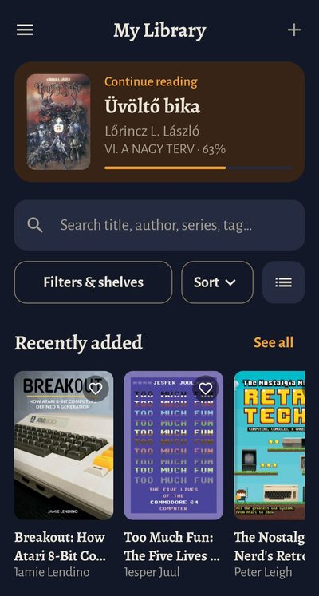
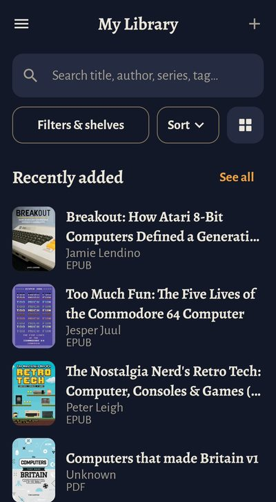
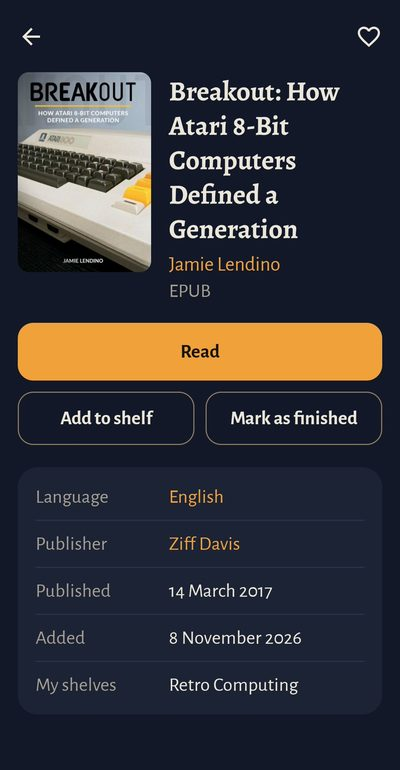
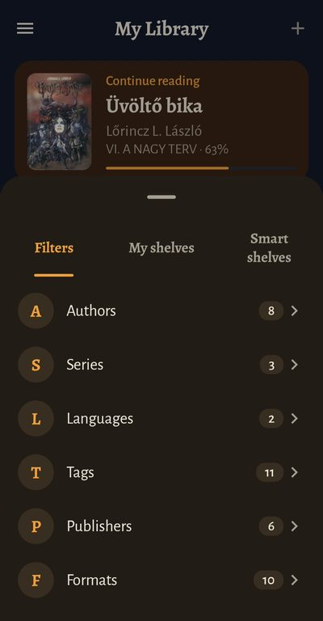
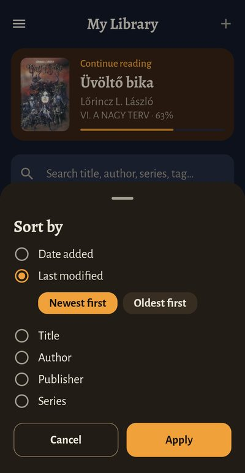
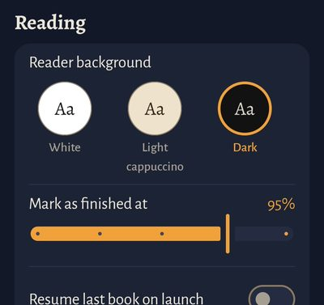

# EasyReader

EasyReader is a private Android app for reading and managing my ebook library, which lives in Calibre on my home server.

It shows everything Calibre knows about each book, lets me read EPUB and PDF books (online or offline), upload new books from my phone or tablet, and keeps my place in every book in sync between devices.

## Screenshots

<table>
  <tr>
    <td align="center"> Home</td>
    <td align="center"> List view</td>
    <td align="center"> Book details</td>
  </tr>
  <tr>
    <td align="center"> Filters &amp; shelves</td>
    <td align="center"> Sort</td>
    <td align="center" valign="top"> Reading settings</td>
  </tr>
</table>

## What it does

- Browse the whole Calibre library: covers, authors, series, tags, languages, publishers, ratings, formats and custom columns
- Search, filter and sort; "Continue reading", "Recently added", "Favourites" and "Unread" rows on the home screen
- Play Books-style shelves, plus "smart shelves" from Calibre's virtual libraries and saved searches
- Read EPUB and PDF with white, light cappuccino or dark backgrounds
- Reading position, shelves, favourites and finished status sync instantly between devices
- Books download automatically when opened; finished books are removed from the device after 7 days
- Upload books from the device straight into Calibre
- Library sync every 10 minutes, or straight away with **Sync Now**

## Devices

Android 13 or newer. Built and tested for a Samsung Galaxy S23 Ultra and a Galaxy Tab S9 FE.

## Installing

1. Open this repo's **Releases** page on the device.
2. Download the latest `.apk` file.
3. When Android asks, allow your browser to install unknown apps (once only).
4. Open EasyReader and enter the server address, username and password.

Updates install over the top of the previous version without losing anything.

## Server

EasyReader needs Calibre's content server running on the home PC, four custom columns in Calibre, and Tailscale for remote access. See [docs/SERVER-SETUP.md](docs/SERVER-SETUP.md).

## Documents

- [docs/SPEC.md](docs/SPEC.md) – full app specification
- [docs/DESIGN.md](docs/DESIGN.md) – colours, fonts and screen layouts
- [docs/SERVER-SETUP.md](docs/SERVER-SETUP.md) – server setup checklist

## Status

Version 1.0.0 released. All five stages are done.

| Stage | What | Status |
| --- | --- | --- |
| 1 | Project skeleton, automatic builds and signed releases, connect to the server, sign in, library as covers | Done |
| 2 | Browse, search, filters, sort and book details | Done |
| 3 | Reader, offline downloads, reading position sync, opening EPUB/PDF files from the device | Done |
| 4 | Shelves, favourites, finished status, smart shelves | Done |
| 5 | Uploads, settings, tablet layout, clean-up, search in book, page curl, polish | Done |
